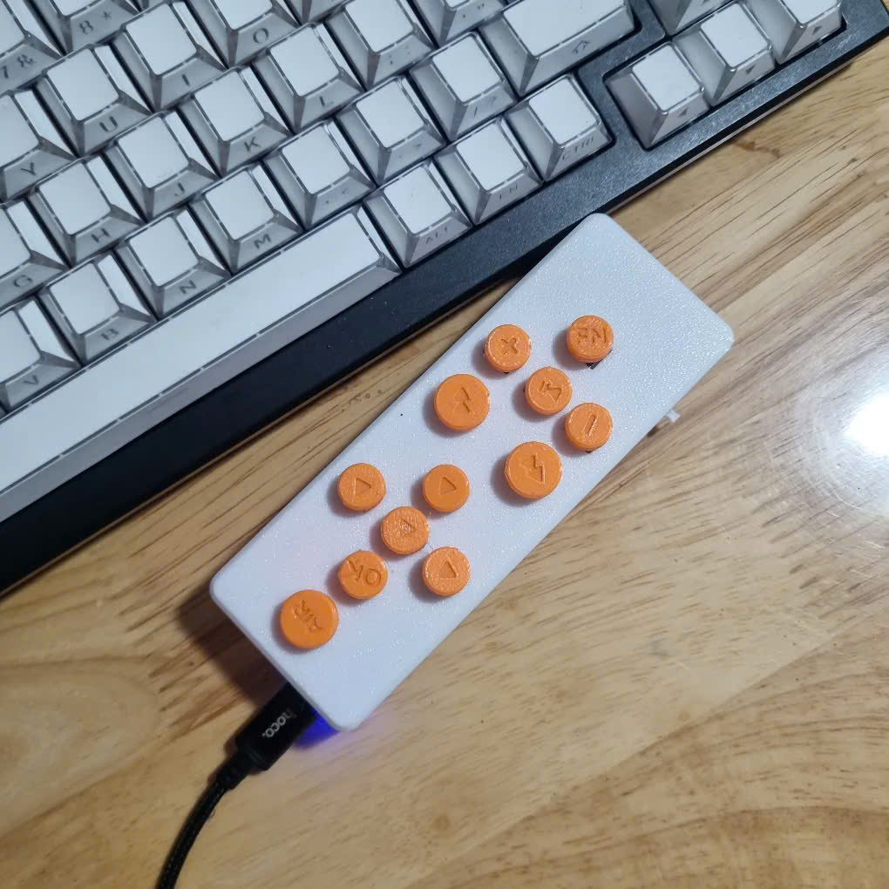
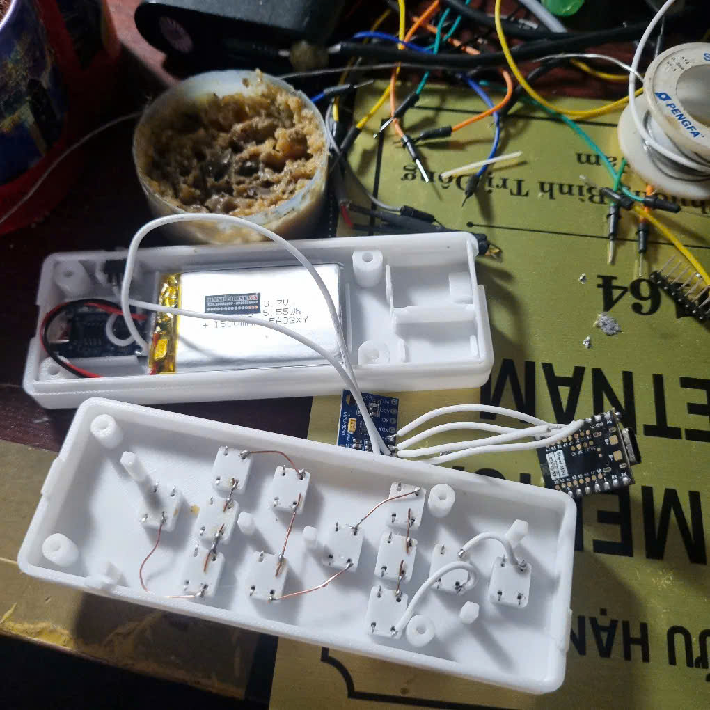

# AirPresenter S3

Remote thuyết trình + chuột bay tự làm: ESP32-S3 SuperMini, cảm biến gyro MPU6050, 12 nút bấm, pin LiPo 1500 mAh, hộp in 3D. Kết nối máy tính qua Bluetooth LE như bàn phím/chuột chuẩn, không cần cài driver.



## Làm được gì

- Chuyển slide, bắt đầu/thoát trình chiếu, màn hình đen, laser pointer của PowerPoint.
- **Chuột bay**: giữ nút AIR rồi xoay cổ tay, con trỏ chạy theo tay. Trái/phải luôn đúng nhờ trọng lực, cầm nghiêng vẫn chạy đúng hướng.
- Click trái/phải, kéo thả, cuộn trang, D-pad di chuột từng chút.
- Phím media: play/pause, âm lượng, mute, bài trước/sau.
- Nút FN trên remote đổi chức năng nút kế tiếp, kiểu phím Shift (giữ hoặc bấm nhả một tay).
- Báo % pin lên Windows/Android, tự ngủ sâu khi không dùng, bấm nút bất kỳ là thức dậy và tự kết nối lại.
- Chạy trên Windows 10/11, macOS, Linux, Android.

## Phần cứng

| Linh kiện | Ghi chú |
|---|---|
| ESP32-S3 SuperMini | BLE HID, LED RGB có sẵn |
| GY-521 (MPU6050) hoặc MPU6500 | I2C, SDA→GPIO12, SCL→GPIO13 |
| 12 nút nhấn 6×6×8 mm | mỗi nút một GPIO, dùng pull-up nội |
| Pin LiPo 3.7 V 1500 mAh (51×34×8 mm) | |
| TP4056 Type-C, công tắc gạt, diode Schottky SS14 | sạc pin, chống backfeed |
| 2 điện trở 100k + tụ 100 nF | đo pin qua GPIO1 |
| 4 ốc M3×10 tự ren | ghép hai nửa vỏ |

## Cấu trúc

```
firmware/    PlatformIO (Arduino + NimBLE): BLE HID, xử lý gyro, nút, nguồn
  src/       remote-user-config.h = mọi thông số chỉnh được; keymap-presenter-default.cpp = gán nút
  test/      unit test logic chuột bay, chạy trên PC: pio test -e native
enclosure/   Hộp OpenSCAD dạng tham số, file STL/STEP để in, ảnh xem trước, viewer 3D trên web
docs/        Hướng dẫn đấu dây, nạp firmware, sử dụng, in và lắp hộp
```

## Bắt đầu

1. Đo linh kiện thật, sửa khối `MEASURE` trong `enclosure/enclosure-parameters.scad`, in hộp: [docs/enclosure-3d-print-and-assembly-guide.md](docs/enclosure-3d-print-and-assembly-guide.md)
2. Đấu dây, nạp firmware, ghép đôi Bluetooth: [docs/hardware-wiring-and-firmware-usage-guide.md](docs/hardware-wiring-and-firmware-usage-guide.md)

```bash
cd firmware
pio run -t upload      # build + nạp qua USB-C
pio device monitor     # log 115200
pio test -e native     # unit test trên PC
```


